<div align="center">

# Roland Aira Compact T-8 Editor

**Edit, generate and play the patterns of your AIRA Compact T-8 — drums and bass — from your computer, over USB.**

[](https://github.com/wcmCloud/Roland-Aira-Compact-T8/releases/latest)
[](#getting-started)
[](https://dotnet.microsoft.com/download)
[](https://github.com/wcmCloud/Roland-Aira-Compact-T8/actions/workflows/ci.yml)

[**⬇&nbsp;Download**](https://github.com/wcmCloud/Roland-Aira-Compact-T8/releases/latest) &nbsp;·&nbsp;
[**📖&nbsp;User guide**](#getting-started) &nbsp;·&nbsp;
[**🎛&nbsp;Connect the T-8**](#connecting-the-t-8) &nbsp;·&nbsp;
[**🛠&nbsp;Build from source**](#build-packages)

<br>

<table>
  <tr>
    <td width="50%">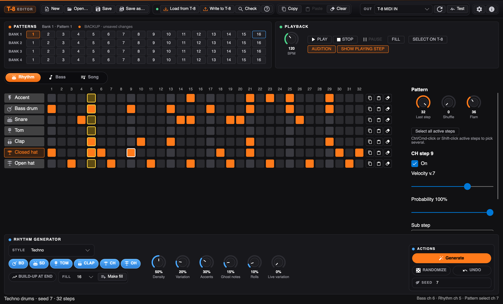</td>
    <td width="50%">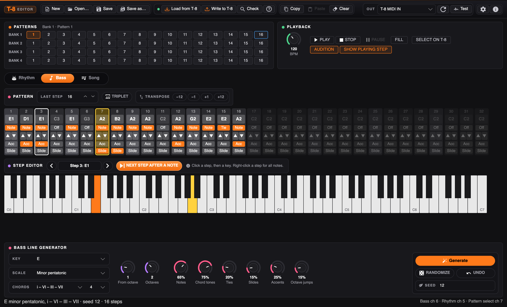</td>
  </tr>
  <tr>
    <td align="center"><b>Rhythm</b> — 7-track step grid, step inspector, style-based generator and fills</td>
    <td align="center"><b>Bass</b> — piano-keyboard step entry and a key, scale and chord aware line generator</td>
  </tr>
  <tr>
    <td colspan="2">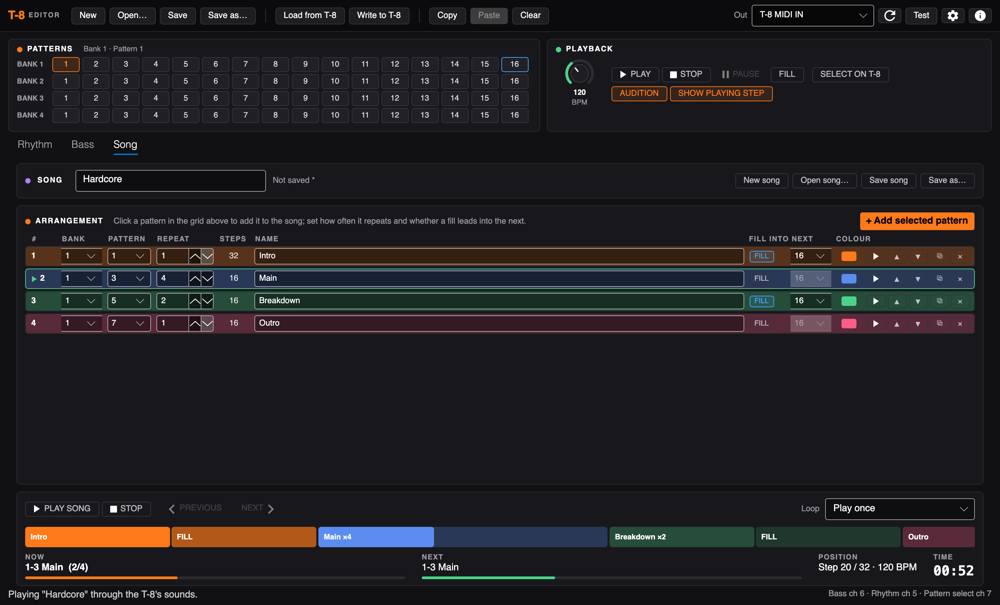</td>
  </tr>
  <tr>
    <td colspan="2" align="center"><b>Song</b> — chain patterns from the banks with repeats and fill bridges, and play the whole song</td>
  </tr>
</table>

</div>

## Highlights

<table>
  <tr>
    <td width="33%" valign="top">
      <h3>🥁 Rhythm editing</h3>
      Click-to-edit grid for all seven T-8 drum tracks, with velocity, probability, sub steps and flams per step,
      and knobs for last step, shuffle and flam.
    </td>
    <td width="33%" valign="top">
      <h3>🎹 Bass editing</h3>
      Select a step and play the note on a C0–C7 piano keyboard; ties, slides and accents; a right-click menu with every note.
    </td>
    <td width="33%" valign="top">
      <h3>🎲 Generators</h3>
      Rhythms in 9 styles from techno to drum &amp; bass, and bass lines in 13 scales over chord progressions —
      seeded, so you can tweak and regenerate.
    </td>
  </tr>
  <tr>
    <td valign="top">
      <h3>🔥 Fills</h3>
      Make a build-up fill for any pattern and hear it with the <b>Fill</b> button, just like FILL TRG on the T-8.
    </td>
    <td valign="top">
      <h3>▶️ Play on the T-8</h3>
      Hear your edits through the T-8's own sounds, or drive its sequencer as clock master — with the playing step lit up.
    </td>
    <td valign="top">
      <h3>🎼 Songs</h3>
      Chain patterns from the banks with repeats and fills as bridges, see the song on a colour timeline, and
      play it through the T-8's sounds or on its own sequencer. Saved as <code>.t8song</code> files.
    </td>
  </tr>
  <tr>
    <td valign="top">
      <h3>💾 Load &amp; write</h3>
      Read all 64 patterns from the T-8's USB drive, save sets on your computer, and write them back.
    </td>
  </tr>
</table>

> [!TIP]
> New here? Download the app for your computer, then follow [Connecting the T-8](#connecting-the-t-8) —
> **Detect from T-8** sets up the MIDI channels for you.

## Contents

| Use the editor | Go further |
|---|---|
| [Getting started](#getting-started) | [Loading patterns from the T-8](#loading-patterns-from-the-t-8) (and the factory banks) |
| [Connecting the T-8](#connecting-the-t-8) | [Sending patterns back to the T-8](#sending-patterns-back-to-the-t-8) |
| [The window](#the-window) | [Command line](#command-line) · [Build packages](#build-packages) |
| [Editing rhythms](#editing-rhythms) · [Generating rhythms](#generating-rhythms) · [Fills](#fills) | [For developers](#for-developers) |
| [Editing bass lines](#editing-bass-lines) · [Generating bass lines](#generating-bass-lines) | |
| [Songs](#songs) · [Playing patterns](#playing-patterns) | |

## Getting started

Download the latest version from the [releases page](https://github.com/wcmCloud/Roland-Aira-Compact-T8/releases/latest).
The downloads are self-contained, so there is nothing else to install:

| Computer | Download |
|---|---|
| Mac with Apple Silicon (M1 and later) | `T8Editor-1.0.0-osx-arm64.zip` |
| Mac with Intel | `T8Editor-1.0.0-osx-x64.zip` |
| Windows PC (x64) | `T8Editor-1.0.0-win-x64.zip` |
| Windows on ARM | `T8Editor-1.0.0-win-arm64.zip` |
| Linux x64 | `T8Editor-1.0.0-linux-x64.tar.gz` |
| Linux ARM64 | `T8Editor-1.0.0-linux-arm64.tar.gz` |

- **macOS:** unzip and move *Roland Aira Compact T-8 Editor* to Applications. It isn't notarized by Apple, so the
  first time right-click it and choose **Open**. If macOS says it is damaged, run
  `xattr -dr com.apple.quarantine "/Applications/Roland Aira Compact T-8 Editor.app"` once.
- **Windows:** unzip and run `T8Editor.exe`. If SmartScreen warns, choose **More info → Run anyway**.
- **Linux:** unpack and run `./T8Editor`. Your user needs access to the MIDI devices (usually the `audio` group).

> [!NOTE]
> The apps aren't signed by Apple or Microsoft, so your system asks once before opening them — that's expected.

Or run it from source with the [.NET 10 SDK](https://dotnet.microsoft.com/download):

```sh
dotnet run --project src/T8.Editor
```

The version is shown in the title bar, and the ⓘ button in the top bar (or the app menu on macOS) opens the About window.

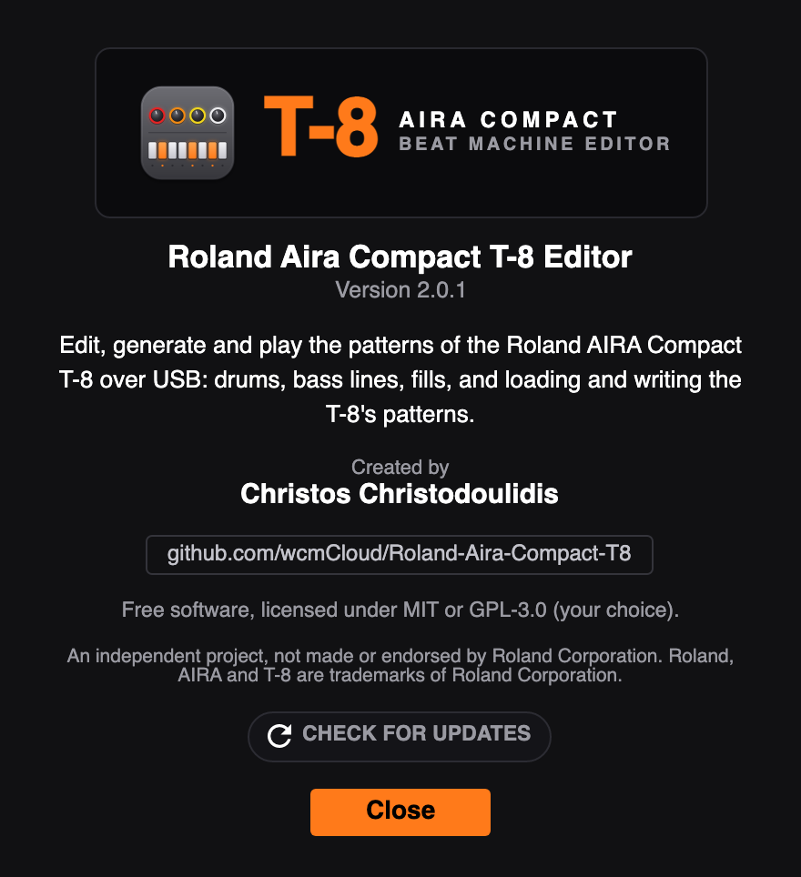

The editor starts with 64 blank patterns. To edit your own, get the T-8's patterns with
[Load from T-8](#loading-patterns-from-the-t-8), or **Open…** a `BACKUP` folder you copied earlier.

## Connecting the T-8

Connect the T-8 to the computer with a USB cable. It shows up as a MIDI port called **T-8** (on macOS,
"T-8 MIDI IN"). Pick it under **Out** in the top bar; press the refresh button if it isn't listed.

The editor and the T-8 must use the same MIDI channels. Open the MIDI settings with the gear button:

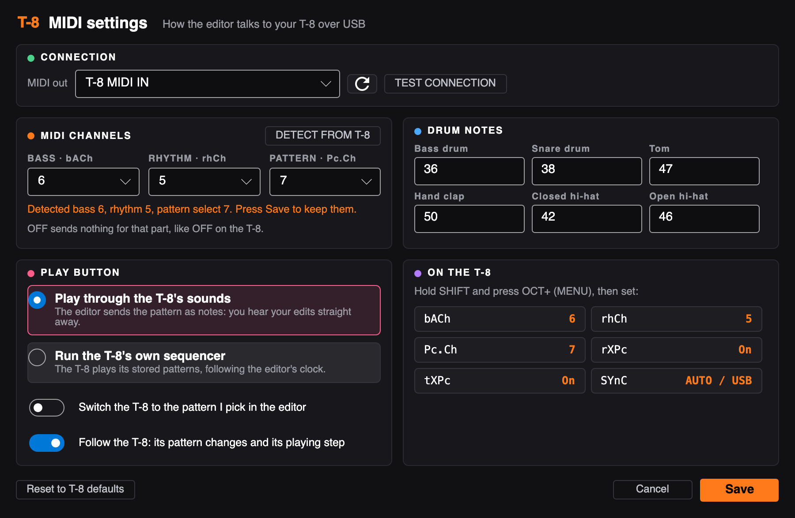

- **Detect from T-8** finds the bass and rhythm channels for you: press it, then press Start on the T-8 and let a
  pattern with drums and bass play. The editor listens to the notes the T-8 sends and fills in the channels.
- Or set them by hand to match the T-8's menu (hold SHIFT, press OCT+): bass `bACh` (default 2), rhythm `rhCh`
  (default 10) and pattern select `Pc.Ch` (default 16). Detect finds pattern select too if `tXPc` is on in the
  T-8's menu and you change pattern while it listens; otherwise set it by hand.
- **OFF** (first choice for Bass and Rhythm) works like OFF for `bACh`/`rhCh` on the T-8: the editor sends nothing
  for that part, so Play, audition and Test leave it silent. Use it to hear or play just the drums or just the bass,
  or when the T-8 has that part's channel set to OFF.
- **Test connection** plays kick, snare, closed hat, open hat and a bass note on those channels, and checks that the
  T-8 answers. If you hear nothing, the channels don't match.
- **Drum note numbers** are the notes for each drum (the T-8's defaults are filled in).
- **Play button** chooses what Play does (see [Playing patterns](#playing-patterns)).
- **Switch the T-8 to the pattern I pick in the editor** sends a pattern change whenever you pick a pattern.
  It needs `rXPc` (receive program change) turned on in the T-8's menu.
- **Follow the T-8** (on by default) works the other way round: when you change pattern on the T-8, the editor
  switches to it (turn `tXPc`, transmit program change, on in the T-8's menu), and when you press Play on the T-8,
  the editor shows its playing step and tempo.

> [!TIP]
> The **On the T-8** card lists the T-8 menu settings that match the editor (bACh, rhCh, Pc.Ch, rXPc, tXPc, SYnC);
> hover over one to see what it's for.
>
> Every message in the T-8's MIDI Implementation Chart, and what the editor does with it, is listed in
> [docs/MIDI.md](docs/MIDI.md).

 Press **Save** to keep the settings;
they are remembered between runs.

## The window

The screenshots at the top show the whole window on each tab. From top to bottom:

- **Top bar:** New (64 blank patterns), Open…, Save, Save as…; Load from T-8 and Write to T-8; Copy, Paste and Clear
  for the current pattern (bass and rhythm together); and on the right the MIDI output, refresh, Test, settings and About (ⓘ).
- **Patterns** and **Playback** cards, described below.
- **Rhythm** and **Bass** tabs with the editors and their generators.
- **Status bar:** what just happened on the left, the MIDI channels in use on the right.

### Patterns

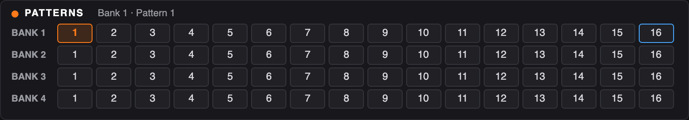

The T-8 has 4 banks of 16 patterns; each pattern has a rhythm part and a bass part. Click any cell to edit that
pattern. The current pattern is outlined in orange, empty patterns are dimmed, and the fill pattern (see
[Fills](#fills)) is outlined in blue.

### Playback

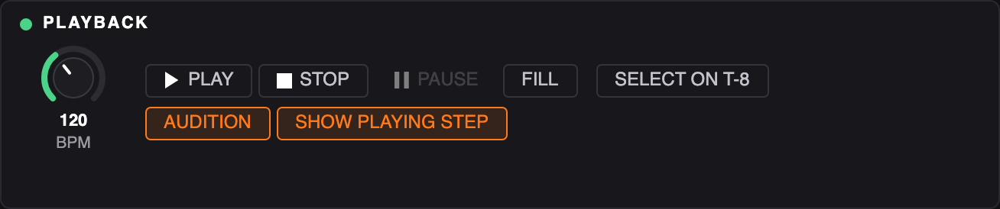

- **BPM** knob: the tempo for Play.
- **Play**, **Pause**, **Stop**: play the current pattern (Play lights green while playing). Pause keeps the place:
  Play (or Pause again) carries on from there, and in sync mode the T-8 gets MIDI Continue. Stop goes back to the start.
- **Fill**: play the fill pattern once after this loop, see [Fills](#fills).
- **Select on T-8**: switch the T-8 to the current pattern.
- **Audition**: play each step on the T-8 as you click it.
- **Show playing step**: highlight the step being played, and the bass note on the keyboard, in yellow.
- When you press Play on the T-8 itself, the Playback card shows **T-8 playing** and its tempo, and the playing step
  follows the T-8 (see *Follow the T-8* below).

### Knobs

Drag a knob up or down to turn it (hold Shift to turn it slowly), or use the scroll wheel or the arrow keys.
Double-click a knob to put it back to its default.

## Editing rhythms

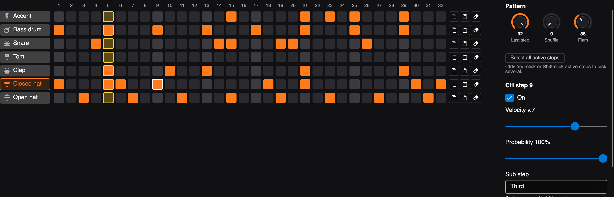

Each row is one of the T-8's tracks: Accent, Bass drum, Snare, Tom, Clap, Closed hat and Open hat. (The T-8's
pattern files also have a CY cymbal track, but the T-8 has no cymbal sound, so the editor hides it; anything
stored in it is kept when you save.) Each column is one of 32 steps; the brighter columns are the beats.

- Click a cell to turn it on or off. The cell you clicked is outlined in white and shown in the inspector on
  the right.
- **Inspector:** On, **Velocity** (v.0–v.10, the T-8 uses v.7 for new notes), **Probability** (how often the step
  plays, as on the T-8), **Sub step** (Half, Third or Quarter: 2, 3 or 4 hits in the step; Flam: a quiet hit just
  before) and the sub step's own probability.
- **Pattern** knobs: **Last step** (1–32, steps after it are dimmed), **Shuffle** (0–200, delays every second
  16th) and **Flam** (0–100, the spacing of a flam's two hits).
- Click a track's name to clear the whole track.

### Editing several steps at once

**Ctrl-click** (Cmd-click on macOS) or **Shift-click** active steps to pick them; they get a blue outline, and
**Select all active steps** picks every active step. The panel on the right then sets **Velocity**,
**Probability**, **Sub step** and **Sub step probability** for all of them: press **Apply** to write the values
to every picked step and clear the selection, or **Clear selection** to leave them as they were. Inactive steps
can't be picked, and switching a picked step off drops it from the selection.

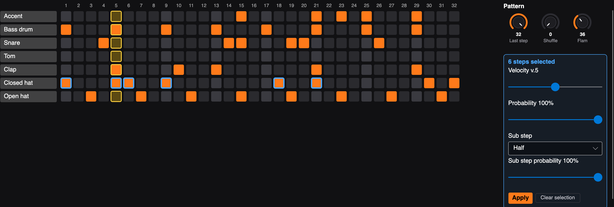

## Generating rhythms

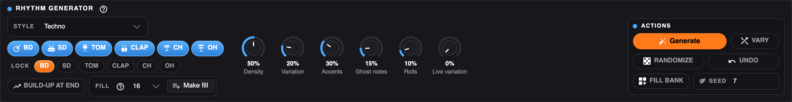

The rhythm generator writes a new drum pattern into the current pattern, up to its last step.

- **Style:** Techno, House, Electro, Breakbeat, Hip-hop / boom bap, Trap, Drum & bass, Minimal / acid or Random.
  Every style has hits that always play, like the four-on-the-floor kick and the off-beat open hats in techno,
  and hits that only play some of the time.
- **Instruments:** BD, SD, TOM, CLAP, CH and OH switch drums on and off for the generator.
- **Build-up at end:** adds snare and tom hits in the last four steps.

| Knob | What it does |
|---|---|
| Density | 50% follows the style; lower thins out the optional hits, higher adds more |
| Variation | Adds hits the style wouldn't play and drops some optional ones |
| Accents | Accents on the T-8's accent track, mostly on the beat |
| Ghost notes | Quiet extra snare and hat hits between the main ones |
| Rolls | Hat rolls (sub steps) and snare flams |
| Live variation | Gives some optional hits a step probability of 50–80%, so the T-8 itself plays the pattern a little differently every loop |

- **Generate** writes a pattern with the current seed: the same settings and seed always give the same pattern,
  so you can change one knob and press Generate again for a variation with the same feel.
- **Randomize** picks a new seed and generates: a different pattern in the same style.
- **Undo** puts back the pattern from before the last Generate, Randomize or Make fill.
- **Seed:** type a number to get a pattern back.

The generator never puts the closed and open hat on the same step, because the T-8's open hat cuts off the closed one.

## Fills

On the T-8 a fill is just another pattern: SHIFT + STEP 8 (FILL PTN) picks which pattern is the fill, and
SHIFT + STEP 7 (FILL TRG) plays it once before going back to the main pattern.

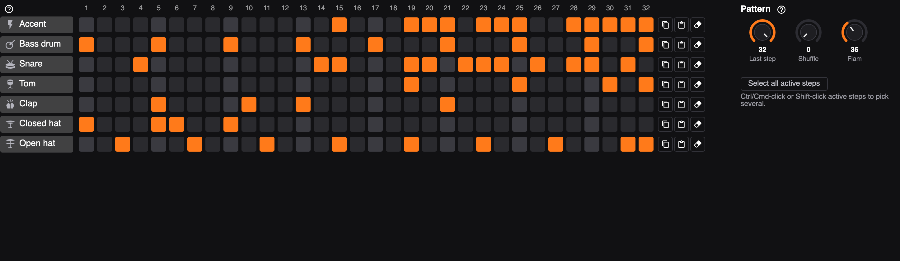

- Set **Fill pattern** in the rhythm generator (pattern 16 of the current bank by default) and press **Make fill**.
  It writes a fill for the pattern you're editing into that slot: the same groove for the first half, then snare
  and tom hits that get denser, louder and rolled towards the end, landing on kick, open hat and accent. It uses
  the generator's instrument switches and seed; **Undo** takes it back.
- Press **Fill** in the Playback card while a pattern plays: the fill plays once, starting exactly at the end of the
  current loop, then the pattern carries on. The bass keeps playing under it.
> [!IMPORTANT]
> After **Write to T-8**, pick the fill on the T-8 itself with **SHIFT + STEP 8** (the T-8 has no MIDI messages for
> this), then trigger it with **SHIFT + STEP 7**.

## Editing bass lines

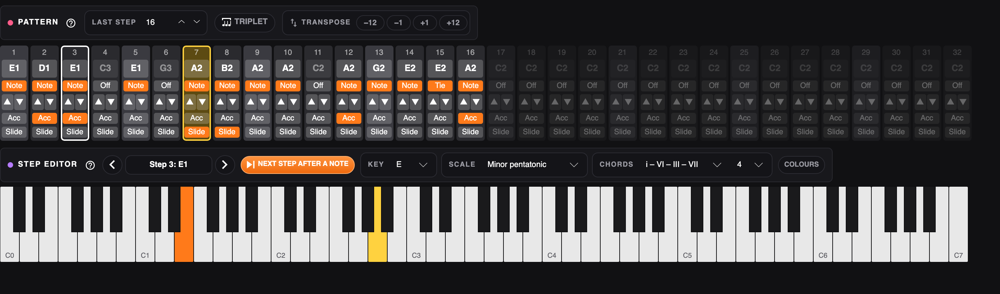

Each column is one step: its note, its state, semitone up/down, and Accent and Slide.

- Click a step's note to select it (outlined in white); its note lights up orange on the keyboard.
- Click a key on the **keyboard** to give the selected step that note. The step is turned on, you hear the note
  on the T-8, and the selection moves to the next step, so you can play a line in key by key. Untick
  **Go to the next step after a note** to stay on the same step. The arrows move the selection.
- The state button cycles **Off → Note → Tie**. A tie holds the previous note through the step.
- **Last step**, **Triplet** and **Transpose** (−12, −1, +1, +12 for the whole line) are above the steps.
- **Right-click a step** for every note in the T-8's range (C0–C7) by octave, plus Off/Note/Tie, Accent and Slide:

  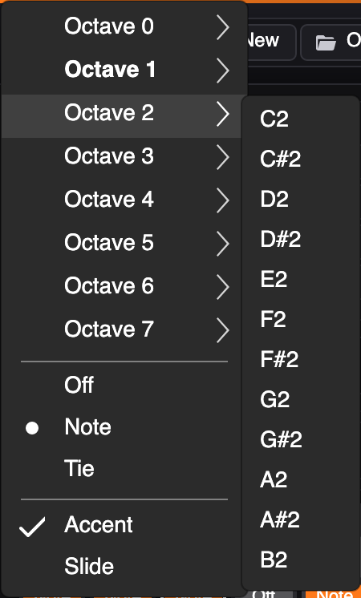

## Generating bass lines

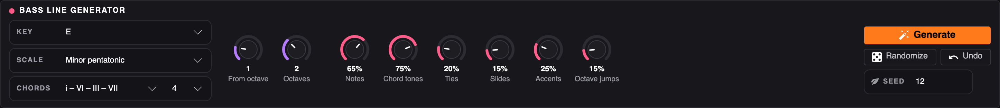

The bass line generator writes a new line into the current pattern, up to its last step, following a key and a scale.

- **Key:** C to B.
- **Scale:** major, natural minor, harmonic minor, melodic minor, major and minor pentatonic, blues, Dorian,
  Phrygian, Lydian, Mixolydian, Locrian and Phrygian dominant.
- **Chords:** none (stays on the root), I – IV – V – I, I – V – vi – IV, i – VI – III – VII, i – VII – VI – VII,
  i – iv or ii – V – I, and how many steps each chord lasts (4, 8, 16 or 32). Chords are built from the scale, so
  in E harmonic minor the V chord is B major.

| Knob | What it does |
|---|---|
| From octave | Octave of the lowest note (1 is the classic bass range) |
| Octaves | How many octaves the line may span |
| Notes | How often a step plays a new note (beats get a bonus) |
| Chord tones | How often a note on the beat is the chord's root, third or fifth |
| Ties | How often a rest after a note holds the note instead |
| Slides | How often a note slides into the next |
| Accents | How often a note is accented |
| Octave jumps | How often a note jumps an octave up or down |

The line always starts on the root, each chord change starts on that chord's root, and it moves mostly in small
steps. **Generate**, **Randomize**, **Undo** and **Seed** work as for rhythms.

## Songs


The **Song** tab chains patterns from the banks into a song.

1. With the Song tab open, **click a pattern in the pattern grid** at the top: it's added to the end of the song,
   named "Bank n - Pattern y". Click the next one, and so on. (**+ Add selected pattern** does the same for the
   pattern that's already open.)
2. For each entry set the **bank** and **pattern**, how many times it **repeats**, a **name** and a **colour**
   (click the swatch to change it). **Steps** shows how long one pass of the pattern is (its last step).
3. Turn on **FILL** to play a fill pattern once after the repeats, as a bridge into the next entry, and pick the
   fill pattern (same bank; 16 by default, as made by [Make fill](#fills)).
4. Reorder with ▲ ▼, duplicate with ⧉, remove with ✕, or press ▶ on a row to play the song from there.

Press **PLAY SONG** to play it. The playing entry is outlined in green, the timeline fills up as the song plays,
and the bottom row shows what's playing now (with the repeat, e.g. 2/4), what comes next, the step and the time.
**PREVIOUS** and **NEXT** jump between entries. **Click a block on the timeline** to play that part next: it
starts as soon as the pattern playing now has finished (outlined in white until then), so you can perform the
song live; when the song is stopped, clicking a block plays the song from there. 

The **Loop** menu sets what happens at the end:

- **Play once:** the song stops after the last entry.
- **Loop whole song:** after the last entry (and its fill) it starts again from the first, and keeps going until
  you press Stop. This is saved with the song.
- **#n: an entry:** keep repeating just that entry while you work on it.

What PLAY SONG does follows the Play mode in the MIDI settings:

- **Through the T-8's sounds:** the editor plays the whole song as notes, straight from the patterns in the editor.
- **On the T-8's own sequencer:** the editor selects the first pattern, sends the clock, and as each pattern
  starts it tells the T-8 the next one, which the T-8 switches to when the current pattern ends. The T-8 needs
  the same patterns as the editor (**Write to T-8** first), `rXPc` on and `SYnC` set to AUTO or USB.

**Save song** / **Open song…** use `.t8song` files, a small JSON format described in
[docs/SONG-FORMAT.md](docs/SONG-FORMAT.md). A song refers to bank and pattern numbers, so it plays whatever patterns
are open; the tempo is saved with it.

## Playing patterns

What **Play** does is set in the MIDI settings:

- **Play the edited pattern through the T-8's sounds:** the editor sends the pattern as notes and the T-8 plays
  them with its sounds. You hear your edits as you make them (the preview restarts after generating), and the Fill
  button works. Stop the T-8's own sequencer first so it doesn't play on top.
- **Run the T-8's own sequencer with the computer as clock master:** the editor switches the T-8 to the pattern
  and sends MIDI clock, so the T-8 plays its stored pattern at the editor's tempo. Set the T-8's `SYnC` to AUTO or
  USB and turn `rXPc` on.

With **Show playing step** on, the playing step is outlined in yellow on both tabs, and the bass note being played
lights up yellow on the keyboard. Each part loops on its own length, as on the T-8.

## Loading patterns from the T-8

The T-8 doesn't send its patterns over MIDI. Instead it can show up on your computer as a USB drive with a
`BACKUP` folder holding all 64 patterns (4 banks × 16), one file per pattern for the rhythm and one for the bass.

### 1. Switch the T-8 into drive mode

1. Connect the T-8 to the computer with a USB cable (the same one used for MIDI).
2. Switch the T-8 **off**.
3. **Hold down the PLAY button and switch the T-8 on.** Keep holding PLAY until the step buttons start lighting up.
4. Wait about a minute: the step buttons light up one after another to show the progress. When the drive is
   ready, a drive named **T-8** appears on the computer (in Finder on macOS, in File Explorer on Windows, under
   `/media` on Linux).

> [!NOTE]
> While the T-8 is in drive mode it isn't a MIDI device, so Play, Test and Detect don't work until you switch
> it off and on again normally.

### 2. Load the patterns into the editor

Press **Load from T-8** in the top bar. The editor finds the T-8 drive and opens its `BACKUP` folder; the 64
patterns appear in the pattern grid.

Then press **Save as…** and pick a folder on your computer, so you keep a copy after the T-8 is switched off.
That copy is a normal backup: you can open it again any time with **Open…**, without the T-8 connected.

> [!TIP]
> If **Load from T-8** says it can't find the drive, wait until the step buttons stop counting, or use **Open…**
> and choose the `BACKUP` folder on the T-8 drive yourself.

When you're done, eject the T-8 drive (drag it to the Trash on macOS, or right-click it and choose **Eject** on
Windows) and switch the T-8 off.

### Getting the factory (default) patterns

There are two ways to start from the patterns the T-8 came with:

- **Without touching the T-8:** this repository includes a backup of the T-8's factory patterns in the
  [`BACKUP`](BACKUP) folder. Download the repository (**Code → Download ZIP** on GitHub), then use **Open…** in the
  editor and choose that `BACKUP` folder.
- **From the T-8 itself, with a factory reset.** This puts the factory patterns back on the T-8, then you load
  them as above.

  > [!CAUTION]
  > A factory reset **erases every pattern on the T-8**. Load and **Save as…** your own patterns first.

  1. Hold down the **SLIDE (WRITE)** button and switch the T-8 on. The display shows `FACt` and the ACCENT
     button blinks. (To cancel, just switch it off.)
  2. Press **ACCENT**. When the display shows `dOnE` and all the buttons blink, switch the T-8 off and on again.
  3. Follow [Switch the T-8 into drive mode](#1-switch-the-t-8-into-drive-mode) and
     [Load the patterns into the editor](#2-load-the-patterns-into-the-editor).

## Sending patterns back to the T-8

The T-8 loads patterns from a `RESTORE` folder on its drive when you press ACCENT. **Write to T-8** fills that
folder for you.

1. Edit your patterns in the editor and **Save** them (so you have a copy on the computer).
2. Put the T-8 in drive mode: switch it off, then **hold PLAY and switch it on**, and wait about a minute for the
   **T-8** drive to appear ([details](#1-switch-the-t-8-into-drive-mode)).
3. Press **Write to T-8** in the top bar and confirm. The editor writes all 64 patterns (bass and rhythm) into
   the drive's `RESTORE` folder.
4. **Eject** the T-8 drive on the computer and wait until it's gone.
5. **Press the ACCENT button on the T-8.** It loads the patterns from the `RESTORE` folder.
6. **Wait until the display shows `dOnE`**, then switch the T-8 off. Switch it on normally to play your patterns.

> [!WARNING]
> Writing replaces **all 64 patterns** on the T-8 with the ones in the editor, so load and save the T-8's
> current patterns first if you want to keep them. Don't switch the T-8 off before it shows `dOnE`.

> [!TIP]
> You can try a pattern before writing it: with the T-8 connected normally (not in drive mode), press **Play** to
> hear the pattern through the T-8's sounds straight from the editor.

The file format is described in [docs/PRM-FORMAT.md](docs/PRM-FORMAT.md) and the MIDI details in [docs/MIDI.md](docs/MIDI.md).

## Command line

The `t8` tool covers the MIDI side without the editor (add `--bass-ch off` or `--rhythm-ch off` to leave a part
silent):

```sh
dotnet run --project src/T8.Cli -- ports
dotnet run --project src/T8.Cli -- detect
dotnet run --project src/T8.Cli -- test --rhythm-ch 10 --bass-ch 2
dotnet run --project src/T8.Cli -- select 2 5
dotnet run --project src/T8.Cli -- preview BACKUP 1 1 --bpm 125
dotnet run --project src/T8.Cli -- clock --bpm 125
dotnet run --project src/T8.Cli -- export BACKUP 1 1 pattern.mid
```

## Build packages

```sh
scripts/publish.sh                 # all six packages into artifacts/
scripts/publish.sh osx-arm64       # just one: osx-arm64, osx-x64, win-arm64, win-x64, linux-arm64, linux-x64
VERSION=1.0.1 scripts/publish.sh   # another version (default: <Version> in src/T8.Editor/T8.Editor.csproj)
```

Packages are self-contained, so no .NET install is needed to run them. On macOS the app bundle is signed ad hoc
(Apple Silicon only runs signed code); it isn't notarized. On Windows you can also run `scripts/publish.ps1`
for the two Windows packages. GitHub Actions (`.github/workflows/ci.yml`) runs the tests on all three OSes and
builds the packages on every push.

### Making a release

Set `<Version>` in `src/T8.Editor/T8.Editor.csproj`, commit and push, then:

```sh
scripts/release.sh
```

It builds the six packages, tags `v<version>`, and creates the GitHub release with them, using
`scripts/release-notes.md` as the description (needs the GitHub CLI, `gh`, signed in).

## For developers

### Projects

| Project | What it does |
|---|---|
| `src/T8.Core` | Reads and writes the T-8's `.PRM` pattern files ([format](docs/PRM-FORMAT.md)) |
| `src/T8.Midi` | USB MIDI with [DryWetMIDI](https://github.com/melanchall/drywetmidi): pattern select, preview through the T-8's sounds, MIDI clock, `.mid` export ([notes](docs/MIDI.md)) |
| `src/T8.Editor` | The desktop editor (Avalonia): rhythm grid with a step inspector, bass lane, bank/pattern picker, copy/paste, preview and audition on the T-8 |
| `src/T8.Cli` | Command-line tool (`t8`) for the MIDI side |
| `tests/*.Tests` | One test project per project above, including headless UI tests of the editor |

### Tests and screenshots

```sh
dotnet test
```

The screenshots in this guide are rendered by the editor's UI tests at a MacBook Air 13" window size
(1470 points wide) at Retina 2×. To update them:

```sh
T8_DOCS_DIR=$PWD/docs/screenshots dotnet test tests/T8.Editor.Tests --filter DocsScreenshots
```
