# Roland Aira Compact T-8 Editor

A desktop editor for the Roland AIRA Compact T-8 beat machine, for macOS, Windows and Linux. Load the patterns
from the T-8, edit the drums and the bass line, generate new ones in a key or a style, hear them on the T-8 over
USB MIDI, and write them back.

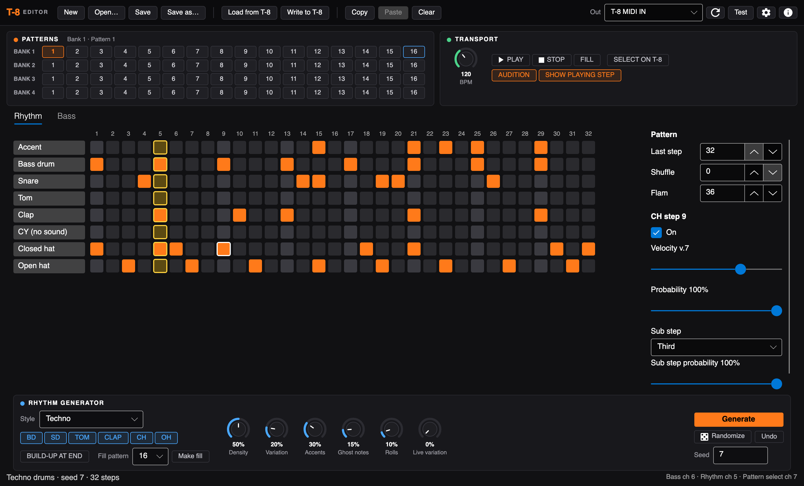

## Contents

- [Getting started](#getting-started)
- [Connecting the T-8](#connecting-the-t-8)
- [The window](#the-window)
- [Editing rhythms](#editing-rhythms)
- [Generating rhythms](#generating-rhythms)
- [Fills](#fills)
- [Editing bass lines](#editing-bass-lines)
- [Generating bass lines](#generating-bass-lines)
- [Playing patterns](#playing-patterns)
- [Getting patterns on and off the T-8](#getting-patterns-on-and-off-the-t-8)
- [Command line](#command-line)
- [Build packages](#build-packages)
- [For developers](#for-developers)

## Getting started

Download the latest version from the [releases page](https://github.com/wcmCloud/Roland-Aira-Compact-T8/releases/latest).
The downloads are self-contained, so there is nothing else to install:

| Computer | Download |
|---|---|
| Mac with Apple Silicon (M1 and later) | `T8Editor-1.0.0-osx-arm64.zip` |
| Mac with Intel | `T8Editor-1.0.0-osx-x64.zip` |
| Windows PC (x64) | `T8Editor-1.0.0-win-x64.zip` |
| Windows on ARM | `T8Editor-1.0.0-win-arm64.zip` |
| Linux x64 | `T8Editor-1.0.0-linux-x64.tar.gz` |
| Linux ARM64 | `T8Editor-1.0.0-linux-arm64.tar.gz` |

- **macOS:** unzip and move *Roland Aira Compact T-8 Editor* to Applications. It isn't notarized by Apple, so the
  first time right-click it and choose **Open**. If macOS says it is damaged, run
  `xattr -dr com.apple.quarantine "/Applications/Roland Aira Compact T-8 Editor.app"` once.
- **Windows:** unzip and run `T8Editor.exe`. If SmartScreen warns, choose **More info → Run anyway**.
- **Linux:** unpack and run `./T8Editor`. Your user needs access to the MIDI devices (usually the `audio` group).

Or run it from source with the [.NET 10 SDK](https://dotnet.microsoft.com/download):

```sh
dotnet run --project src/T8.Editor
```

The version is shown in the title bar, and the ⓘ button in the top bar (or the app menu on macOS) opens the About window.

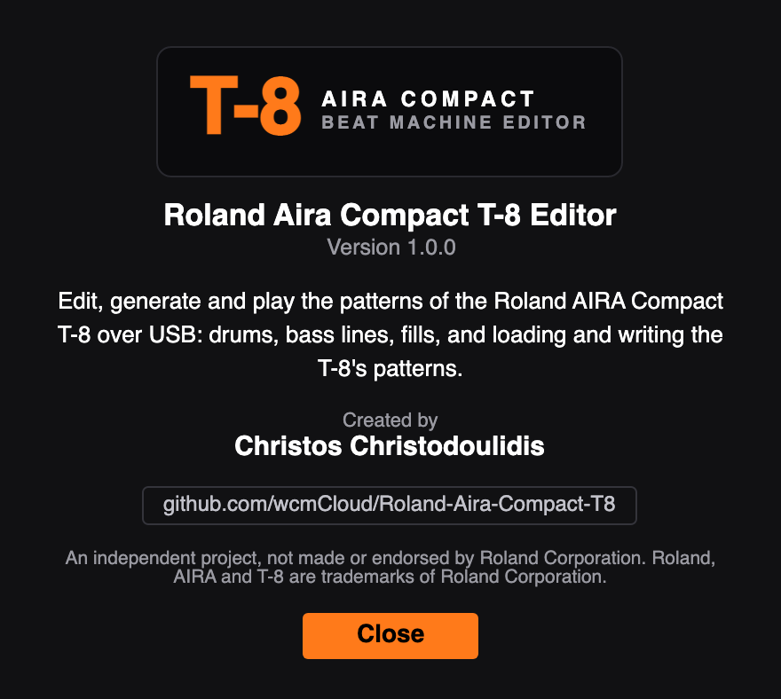

The editor starts with 64 blank patterns. To edit your own, get the T-8's patterns with
[Load from T-8](#getting-patterns-on-and-off-the-t-8), or **Open…** a `BACKUP` folder you copied earlier.

## Connecting the T-8

Connect the T-8 to the computer with a USB cable. It shows up as a MIDI port called **T-8** (on macOS,
"T-8 MIDI IN"). Pick it under **Out** in the top bar; press the refresh button if it isn't listed.

The editor and the T-8 must use the same MIDI channels. Open the MIDI settings with the gear button:

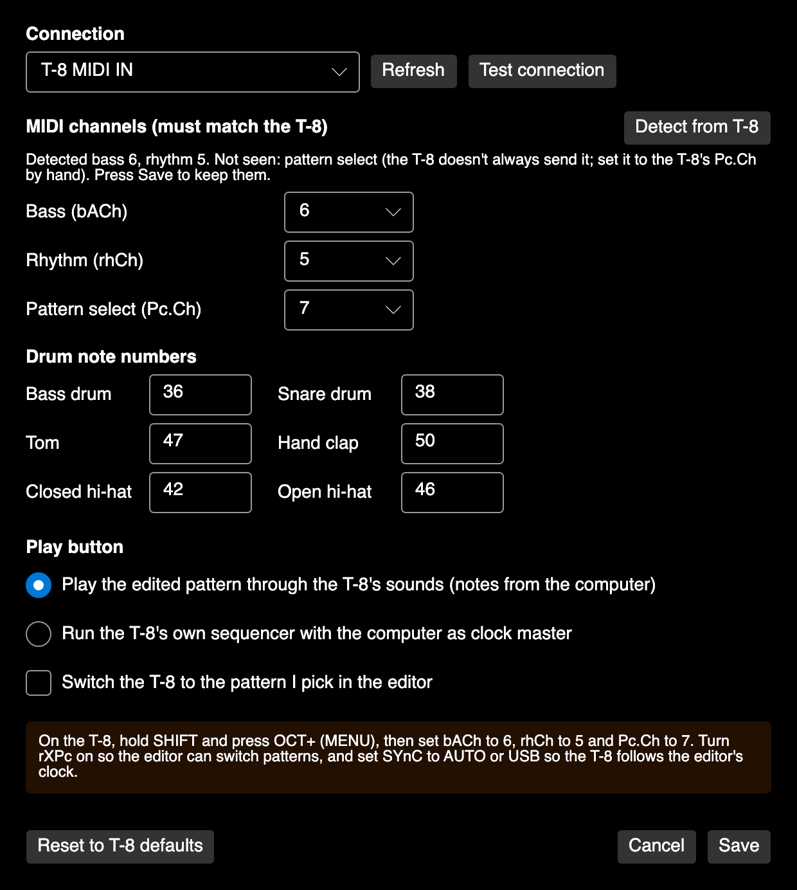

- **Detect from T-8** finds the bass and rhythm channels for you: press it, then press Start on the T-8 and let a
  pattern with drums and bass play. The editor listens to the notes the T-8 sends and fills in the channels.
- Or set them by hand to match the T-8's menu (hold SHIFT, press OCT+): bass `bACh` (default 2), rhythm `rhCh`
  (default 10) and pattern select `Pc.Ch` (default 16). The T-8 doesn't send anything when you change pattern on
  it, so pattern select always has to be set by hand.
- **Test connection** plays kick, snare, closed hat, open hat and a bass note on those channels, and checks that the
  T-8 answers. If you hear nothing, the channels don't match.
- **Drum note numbers** are the notes for each drum (the T-8's defaults are filled in).
- **Play button** chooses what Play does (see [Playing patterns](#playing-patterns)).
- **Switch the T-8 to the pattern I pick in the editor** sends a pattern change whenever you pick a pattern.
  It needs `rXPc` (receive program change) turned on in the T-8's menu.

The box at the bottom always says which T-8 menu settings match the editor. Press **Save** to keep the settings;
they are remembered between runs.

## The window

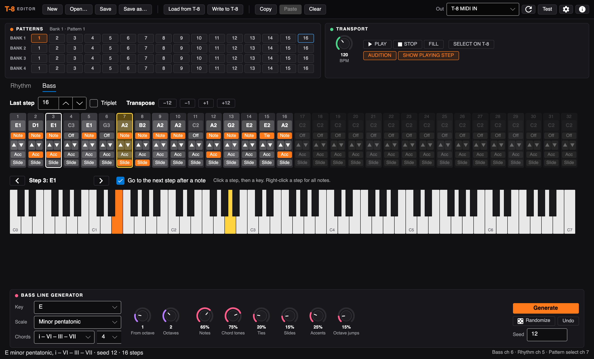

- **Top bar:** New (64 blank patterns), Open…, Save, Save as…; Load from T-8 and Write to T-8; Copy, Paste and Clear
  for the current pattern (bass and rhythm together); and on the right the MIDI output, refresh, Test and settings.
- **Patterns** and **Transport** cards, described below.
- **Rhythm** and **Bass** tabs with the editors and their generators.
- **Status bar:** what just happened on the left, the MIDI channels in use on the right.

### Patterns


The T-8 has 4 banks of 16 patterns; each pattern has a rhythm part and a bass part. Click any cell to edit that
pattern. The current pattern is outlined in orange, empty patterns are dimmed, and the fill pattern (see
[Fills](#fills)) is outlined in blue.

### Transport

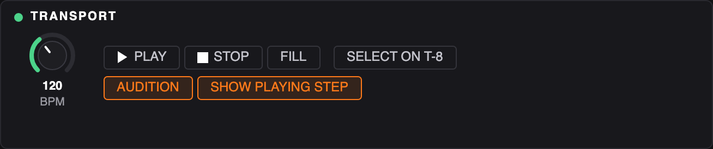

- **BPM** knob: the tempo for Play.
- **Play**, **Stop**: play the current pattern (Play lights green while playing).
- **Fill**: play the fill pattern once after this loop, see [Fills](#fills).
- **Select on T-8**: switch the T-8 to the current pattern.
- **Audition**: play each step on the T-8 as you click it.
- **Show playing step**: highlight the step being played, and the bass note on the keyboard, in yellow.

### Knobs

Drag a knob up or down to turn it (hold Shift to turn it slowly), or use the scroll wheel or the arrow keys.
Double-click a knob to put it back to its default.

## Editing rhythms

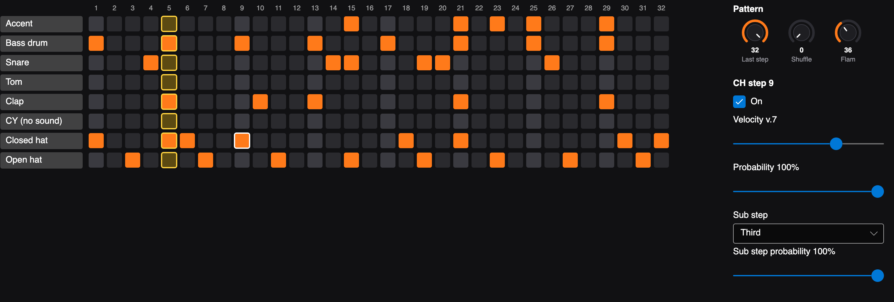

Each row is one of the T-8's tracks: Accent, Bass drum, Snare, Tom, Clap, CY (stored in the file but the T-8 has no
cymbal sound), Closed hat and Open hat. Each column is one of 32 steps; the brighter columns are the beats.

- Click a cell to turn it on or off. The cell you clicked is outlined in white and shown in the inspector on
  the right.
- **Inspector:** On, **Velocity** (v.0–v.10, the T-8 uses v.7 for new notes), **Probability** (how often the step
  plays, as on the T-8), **Sub step** (Half, Third or Quarter: 2, 3 or 4 hits in the step; Flam: a quiet hit just
  before) and the sub step's own probability.
- **Pattern:** **Last step** (1–32, steps after it are dimmed), **Shuffle** and **Flam** amount.
- Click a track's name to clear the whole track.

## Generating rhythms

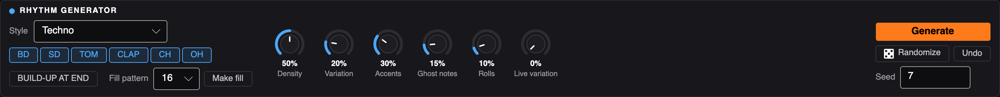

The rhythm generator writes a new drum pattern into the current pattern, up to its last step.

- **Style:** Techno, House, Electro, Breakbeat, Hip-hop / boom bap, Trap, Drum & bass, Minimal / acid or Random.
  Every style has hits that always play, like the four-on-the-floor kick and the off-beat open hats in techno,
  and hits that only play some of the time.
- **Instruments:** BD, SD, TOM, CLAP, CH and OH switch drums on and off for the generator.
- **Build-up at end:** adds snare and tom hits in the last four steps.

| Knob | What it does |
|---|---|
| Density | 50% follows the style; lower thins out the optional hits, higher adds more |
| Variation | Adds hits the style wouldn't play and drops some optional ones |
| Accents | Accents on the T-8's accent track, mostly on the beat |
| Ghost notes | Quiet extra snare and hat hits between the main ones |
| Rolls | Hat rolls (sub steps) and snare flams |
| Live variation | Gives some optional hits a step probability of 50–80%, so the T-8 itself plays the pattern a little differently every loop |

- **Generate** writes a pattern with the current seed: the same settings and seed always give the same pattern,
  so you can change one knob and press Generate again for a variation with the same feel.
- **Randomize** picks a new seed and generates: a different pattern in the same style.
- **Undo** puts back the pattern from before the last Generate, Randomize or Make fill.
- **Seed:** type a number to get a pattern back.

The generator never puts the closed and open hat on the same step, because the T-8's open hat cuts off the closed one.

## Fills

On the T-8 a fill is just another pattern: SHIFT + STEP 8 (FILL PTN) picks which pattern is the fill, and
SHIFT + STEP 7 (FILL TRG) plays it once before going back to the main pattern.

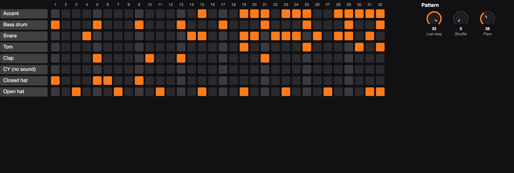

- Set **Fill pattern** in the rhythm generator (pattern 16 of the current bank by default) and press **Make fill**.
  It writes a fill for the pattern you're editing into that slot: the same groove for the first half, then snare
  and tom hits that get denser, louder and rolled towards the end, landing on kick, open hat and accent. It uses
  the generator's instrument switches and seed; **Undo** takes it back.
- Press **Fill** in the transport while a pattern plays: the fill plays once, starting exactly at the end of the
  current loop, then the pattern carries on. The bass keeps playing under it.
- After **Write to T-8**, pick the fill on the T-8 itself with SHIFT + STEP 8 (the T-8 has no MIDI messages for
  this), then trigger it with SHIFT + STEP 7.

## Editing bass lines

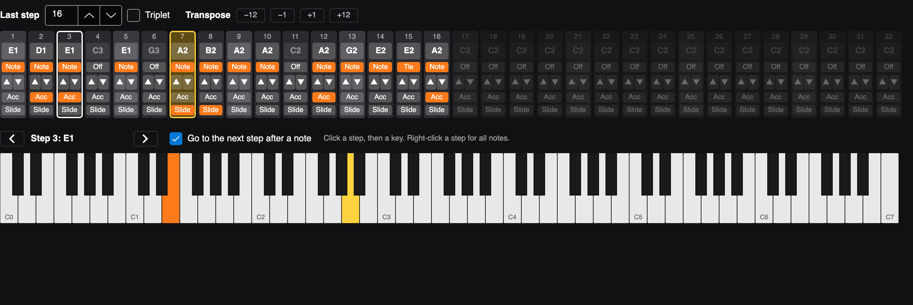

Each column is one step: its note, its state, semitone up/down, and Accent and Slide.

- Click a step's note to select it (outlined in white); its note lights up orange on the keyboard.
- Click a key on the **keyboard** to give the selected step that note. The step is turned on, you hear the note
  on the T-8, and the selection moves to the next step, so you can play a line in key by key. Untick
  **Go to the next step after a note** to stay on the same step. The arrows move the selection.
- The state button cycles **Off → Note → Tie**. A tie holds the previous note through the step.
- **Last step**, **Triplet** and **Transpose** (−12, −1, +1, +12 for the whole line) are above the steps.
- **Right-click a step** for every note in the T-8's range (C0–C7) by octave, plus Off/Note/Tie, Accent and Slide:

  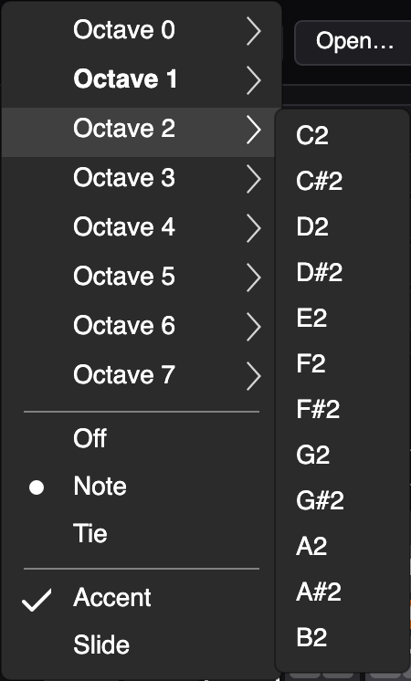

## Generating bass lines

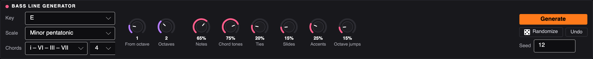

The bass line generator writes a new line into the current pattern, up to its last step, following a key and a scale.

- **Key:** C to B.
- **Scale:** major, natural minor, harmonic minor, melodic minor, major and minor pentatonic, blues, Dorian,
  Phrygian, Lydian, Mixolydian, Locrian and Phrygian dominant.
- **Chords:** none (stays on the root), I – IV – V – I, I – V – vi – IV, i – VI – III – VII, i – VII – VI – VII,
  i – iv or ii – V – I, and how many steps each chord lasts (4, 8, 16 or 32). Chords are built from the scale, so
  in E harmonic minor the V chord is B major.

| Knob | What it does |
|---|---|
| From octave | Octave of the lowest note (1 is the classic bass range) |
| Octaves | How many octaves the line may span |
| Notes | How often a step plays a new note (beats get a bonus) |
| Chord tones | How often a note on the beat is the chord's root, third or fifth |
| Ties | How often a rest after a note holds the note instead |
| Slides | How often a note slides into the next |
| Accents | How often a note is accented |
| Octave jumps | How often a note jumps an octave up or down |

The line always starts on the root, each chord change starts on that chord's root, and it moves mostly in small
steps. **Generate**, **Randomize**, **Undo** and **Seed** work as for rhythms.

## Playing patterns

What **Play** does is set in the MIDI settings:

- **Play the edited pattern through the T-8's sounds:** the editor sends the pattern as notes and the T-8 plays
  them with its sounds. You hear your edits as you make them (the preview restarts after generating), and the Fill
  button works. Stop the T-8's own sequencer first so it doesn't play on top.
- **Run the T-8's own sequencer with the computer as clock master:** the editor switches the T-8 to the pattern
  and sends MIDI clock, so the T-8 plays its stored pattern at the editor's tempo. Set the T-8's `SYnC` to AUTO or
  USB and turn `rXPc` on.

With **Show playing step** on, the playing step is outlined in yellow on both tabs, and the bass note being played
lights up yellow on the keyboard. Each part loops on its own length, as on the T-8.

## Getting patterns on and off the T-8

Switch the T-8 on while holding **PLAY**; it appears on the computer as a drive named `T-8`.

- **Load from T-8** opens the 64 patterns in the drive's `BACKUP` folder.
- **Write to T-8** writes all 64 patterns to the drive's `RESTORE` folder. Then eject the drive and press
  **ACCENT** on the T-8, and wait for `dOnE` before switching it off.
- **Save** and **Save as…** store the patterns in a folder on the computer, in the same layout as the T-8's
  backup, so you can keep several sets and open them again later.

The file format is described in [docs/PRM-FORMAT.md](docs/PRM-FORMAT.md) and the MIDI details in [docs/MIDI.md](docs/MIDI.md).

## Command line

The `t8` tool covers the MIDI side without the editor:

```sh
dotnet run --project src/T8.Cli -- ports
dotnet run --project src/T8.Cli -- detect
dotnet run --project src/T8.Cli -- test --rhythm-ch 10 --bass-ch 2
dotnet run --project src/T8.Cli -- select 2 5
dotnet run --project src/T8.Cli -- preview BACKUP 1 1 --bpm 125
dotnet run --project src/T8.Cli -- clock --bpm 125
dotnet run --project src/T8.Cli -- export BACKUP 1 1 pattern.mid
```

## Build packages

```sh
scripts/publish.sh                 # all six packages into artifacts/
scripts/publish.sh osx-arm64       # just one: osx-arm64, osx-x64, win-arm64, win-x64, linux-arm64, linux-x64
VERSION=1.0.1 scripts/publish.sh   # another version (default: <Version> in src/T8.Editor/T8.Editor.csproj)
```

Packages are self-contained, so no .NET install is needed to run them. On macOS the app bundle is signed ad hoc
(Apple Silicon only runs signed code); it isn't notarized. On Windows you can also run `scripts/publish.ps1`
for the two Windows packages. GitHub Actions (`.github/workflows/ci.yml`) runs the tests on all three OSes and
builds the packages on every push.

### Making a release

Set `<Version>` in `src/T8.Editor/T8.Editor.csproj`, commit and push, then:

```sh
scripts/release.sh
```

It builds the six packages, tags `v<version>`, and creates the GitHub release with them, using
`scripts/release-notes.md` as the description (needs the GitHub CLI, `gh`, signed in).

## For developers

### Projects

| Project | What it does |
|---|---|
| `src/T8.Core` | Reads and writes the T-8's `.PRM` pattern files ([format](docs/PRM-FORMAT.md)) |
| `src/T8.Midi` | USB MIDI with [DryWetMIDI](https://github.com/melanchall/drywetmidi): pattern select, preview through the T-8's sounds, MIDI clock, `.mid` export ([notes](docs/MIDI.md)) |
| `src/T8.Editor` | The desktop editor (Avalonia): rhythm grid with a step inspector, bass lane, bank/pattern picker, copy/paste, preview and audition on the T-8 |
| `src/T8.Cli` | Command-line tool (`t8`) for the MIDI side |
| `tests/*.Tests` | One test project per project above, including headless UI tests of the editor |

### Tests and screenshots

```sh
dotnet test
```

The screenshots in this guide are rendered by the editor's UI tests at a MacBook Air 13" window size
(1470 points wide) at Retina 2×. To update them:

```sh
T8_DOCS_DIR=$PWD/docs/images dotnet test tests/T8.Editor.Tests --filter DocsScreenshots
```
